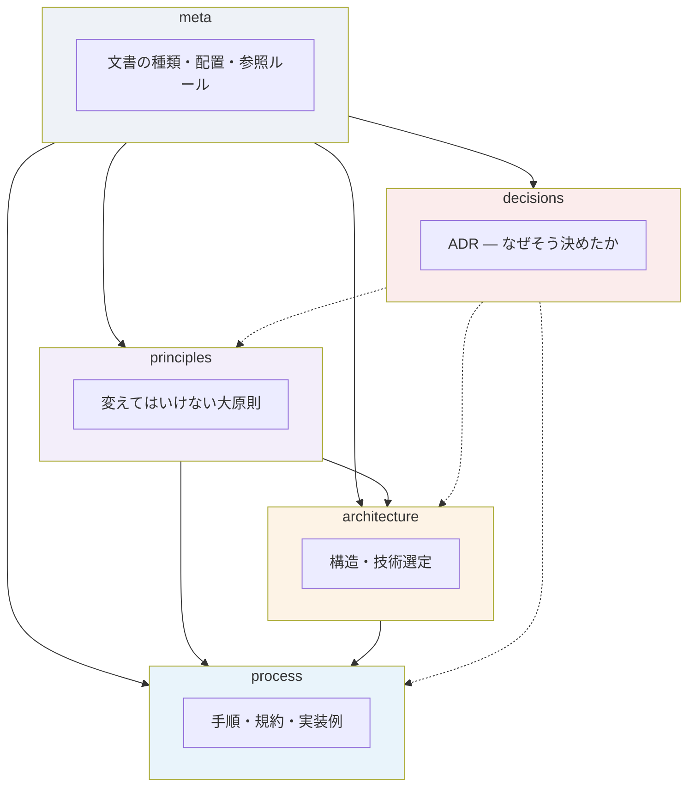

# decisions — 決定の記録（ADR）

この層が持つのは「**なぜこうしたか**」だけである。技術決定・アーキテクチャの選択・プロセスの決定を ADR（Architecture Decision Record）の形で書き残し、当時の文脈・検討した選択肢・却下の理由を、後から人間と AI が同じ材料で読み直せるようにする。

**このファイルが decisions の唯一の入口である**（人間にも AI にも）。根拠は [ADR-0005](./common/ADR-0005-single-entry-point.md) — 入口が 2 つあると腐る場所が 2 つになる。

## ドキュメント体系の全体像



実線は「上の層が下の層を縛る」向き、点線は「ADR は全部を参照できる」ことを表す。ADR は結論ではなく**結論の理由**を書く場所なので、原則・アーキテクチャ・プロセスのどれでも根拠として引ける。逆に、他の全レイヤーが ADR を「この決定に基づく」と明示して参照してよい。

各層の入口は [meta](../meta/README.md) / [principles](../principles/README.md) / [architecture](../architecture/README.md) / [process](../process/backend/README.md) にある。層の全体像は [docs/rules/README.md](../README.md) が持つ。

## このディレクトリの目的

**この層の担当領域は、技術決定・アーキテクチャ選択・プロセス決定の重要事項である。** 一言で言えば「なぜこうしたか」を記録し、後から振り返れるようにする。

| 目的 | 何のために |
|---|---|
| 意思決定の透明化 | なぜその選択なのか、他の選択肢は何だったのかを残す |
| 歴史の保存 | 時間が経っても、当時の文脈と理由を追跡できる |
| コミュニケーション | チーム内・新規参加者に背景を伝える |
| 変更の根拠 | 将来その決定を見直すときの材料になる |

### ADR と 3 台帳の線引き

決定の記録は ADR だけではない。日々の決定は、まず次の 3 台帳に落ちる。

| 置き場 | 何を持つか | 正典か |
|---|---|---|
| `NOTES.md` | 決定の**経緯**の一次記録。作業ログ | いいえ |
| `BACKLOG.md` | 未処理項目の正。消し込み式 | 未処理項目については正 |
| `docs/handoff/review-queue.md`(開発用リポジトリの台帳) | ユーザーの判断待ちの論点 | いいえ |

**現状の運用では、ADR に上がるのは後から効いてくる構造上の決定である。** 「その決定を知らない人が、半年後に同じ場所で同じ判断を迫られる」ものがそれにあたり、日々の裁定（この関数名をどうするか、この文言をどう直すか）は `NOTES.md` に留まっている。ADR が増えすぎると「読めば全部わかる」性質が失われるため、この使い分け自体は理にかなっている。

**ただし、この線引きはまだ正式化されていない。** どこからを ADR にするかの判断基準は決まっておらず（[ADR-0001](./common/ADR-0001-adopt-adr.md) の Notes、[common/README.md](./common/README.md)）、いまのところ運用の説明であって規範ではない。ADR にすべきものが `NOTES.md` に埋もれる記録漏れは起こりうる。

昇格の向きは `NOTES.md`（経緯）→ ADR（決定と理由）→ 必要なら `docs/rules/` の他の層（規範そのもの）になる。ADR は「決めた」という事実と理由を持つのであって、規範の本文は持たない。

## ディレクトリ構造

```text
decisions/
├── README.md          # このファイル（層の唯一の入口）
├── common/            # プロジェクト横断の決定
│   ├── README.md      # 決定一覧（時系列・カテゴリ別）
│   ├── template.md    # ADR テンプレート
│   └── ADR-0001-adopt-adr.md ...
├── backend/           # バックエンド固有の決定
│   ├── README.md
│   ├── template.md
│   └── ADR-BE-0001-....md ...
└── frontend/          # フロントエンド固有の決定
    ├── README.md
    ├── template.md
    └── ADR-FE-0001-....md ...
```

**ADR 本体は各スコープの直下にフラットに置く。サブディレクトリを切ってはいけない。** カテゴリで階層を作ると、1 件が複数カテゴリに跨るたびに置き場所の議論が発生し、しかも移動すると被参照リンクが切れる。分類は各スコープの README.md の「カテゴリ別」節が担い、ファイルの位置は ID だけで決まる状態を保つ。

## ADR の書き方

1. **テンプレートをコピーする。** 次の番号はそのスコープのディレクトリで確認する。

   ```bash
   ls docs/rules/decisions/common/ADR-*.md | tail -1
   cp docs/rules/decisions/common/template.md \
      docs/rules/decisions/common/ADR-0008-my-decision.md
   ```

2. **フロントマターを記入する。** `doc_type: decision` / `scope` / `id` / `status`（まず `proposed`、承認されたら `accepted`）/ `targets`（この決定が効く対象）/ `date`（決定日）/ `norms`（根拠となる原則・アーキテクチャの id）。必須項目は M1 が検査する。

3. **本文を記入する。** 4 つの節が中核である。

   | 節 | 書くこと |
   |---|---|
   | Context | なぜこの決定が必要になったか |
   | Decision | 何を決めたか |
   | Consequences | どんな影響があるか（Negative を必ず書く） |
   | Alternatives Considered | 他にどんな選択肢があり、なぜ却下したか |

4. **そのスコープの README.md に追加する。** 「全決定（時系列）」の表と「カテゴリ別」の節の**両方**に書く。これは一覧の維持義務であり、片方だけの追記は不備として扱う。一覧が全量でなくなった瞬間に、ADR は「探せば見つかるかもしれない記録」に落ちる。

承認（`proposed` → `accepted`）を出すのはユーザーである。このリポジトリの標準の進め方であるビルダー×レビュアー体制（設計凍結 → 実装 → 独立レビュー → 裁定）でも、裁定者はユーザーであり、レビュアーでもビルダーでもない。

## ADR の ID 形式

| scope | ID 形式 | 例 |
|---|---|---|
| common | `ADR-0001-xxx` | `ADR-0001-adopt-adr.md` |
| backend | `ADR-BE-0001-xxx` | `ADR-BE-0004-supabase-as-backend.md` |
| frontend | `ADR-FE-0001-xxx` | `ADR-FE-0001-nextjs-app-router.md` |

規範は 3 つである。

- **連番は scope ごとに独立している。** common の 0003 と backend の BE-0003 は無関係である。
- **一度使った番号は再付与しない。** 移植元で使われた番号も含む（backend の ADR-BE-0001〜0003 が該当。[backend/README.md](./backend/README.md) を見る）。同じ id が時期によって別の決定を指すと、`decisions:` の参照が静かに嘘になる。
- **廃番も削除しない。** ファイルは残したまま `status` を `deprecated` か `superseded` にする。決定を取り消した事実そのものが記録である。

id の形式は M2 が検査する。形式の正は [id_policy.md](../meta/standards/id_policy.md) にある。

## ADR の Status

| status | 説明 |
|---|---|
| `proposed` | 提案中・レビュー待ち |
| `accepted` | 承認済み・実施中 |
| `deprecated` | 非推奨。新しい決定を推奨する |
| `superseded` | 上書きされた。別の ADR で置き換えられている |

`status` はフロントマターと本文の Status 節の**両方**に書く。本文側には日付を添え、`deprecated` なら理由を、`superseded` なら置き換えた側の id を書く（書式はテンプレートの Status 節にある）。

## 参照方法

参照はフロントマターで行う。書式の正は [reference_policy.md](../meta/standards/reference_policy.md) にある。

| 向き | フィールド | 意味 |
|---|---|---|
| 他文書 → ADR | `decisions: [ADR-BE-0001, ADR-BE-0003]` | この決定に基づいている |
| ADR → 他文書 | `norms: [PRIN-0001, ARCH-BE-0013]` | 根拠となる原則・アーキテクチャ |

参照先の id が実在することは M3 が、`norms:` が循環しないことは M6 が検査する。

## よくある質問

**ADR を書くのはどんなときか。**

- 重要な技術選定（フレームワーク・ライブラリ・ツール）
- アーキテクチャ決定（レイヤー構成・依存関係・パターン）
- プロセス変更（開発フロー・テスト戦略・デプロイ方法）
- 規約・命名（重要なコーディング規約・命名ルール）

目安は「**なぜこうしたか**を後で説明する必要がありそうなら書く」である。説明が要らない程度の裁定は `NOTES.md` に留める（上の「ADR と 3 台帳の線引き」）。

**書いた ADR を後から変更してよいか。**

基本的に変更しない。決定は「その時点でそう決めた」という記録であり、書き換えると記録ではなくなる。

- 誤字・リンクの修正は変更に当たらないので直してよい
- 決定そのものを変えるときは、新しい ADR を書き、古い方を `superseded` にする
- 補足を足したいときも、新しい ADR を書いて Related Decisions で繋ぐ

**フラット構造で探しにくくないか。**

3 つの探し方がある。

- 各スコープの README.md がカテゴリ別に分類している（Architecture / Infrastructure / Testing など）
- id で引く（他文書の `decisions:` から辿る）
- ファイル名で探す（`ls docs/rules/decisions/common/`、本文なら `grep -rl "Vercel" docs/rules/decisions/`）

## 次に読むべきファイル

- [common/README.md](./common/README.md) — プロジェクト横断の決定一覧
- [backend/README.md](./backend/README.md) — バックエンドの決定一覧
- [frontend/README.md](./frontend/README.md) — フロントエンドの決定一覧
- [common/template.md](./common/template.md) — ADR テンプレート

## AI向けナビゲーション

- **この層の責務**: 選択理由の記録（なぜその選択か）。管理対象は 4 点 — 文脈 / 選択肢 / 結論 / 結果。これらを ADR 形式で持つ。
- **参照の向き**: `decisions` は `principle` / `architecture` / ドメイン仕様(`role_spec` 等)を参照できる（決定の前提として）。`principle` / ドメイン仕様 / `architecture` / `process` / `spec` は `decisions` を参照してよい（「この決定に基づく」と明示する）。
- **参照方法**: [reference_policy.md](../meta/standards/reference_policy.md) に従い、フロントマターの `decisions` フィールドを使う。本文にリンクを埋めるだけの参照にしない。
- **ここに書かないこと**:
  - 原則・アーキテクチャ・仕様の本文（それぞれの doc_type の文書に書く）
  - 実装手順の詳細（[process](../process/backend/README.md) に書く）
