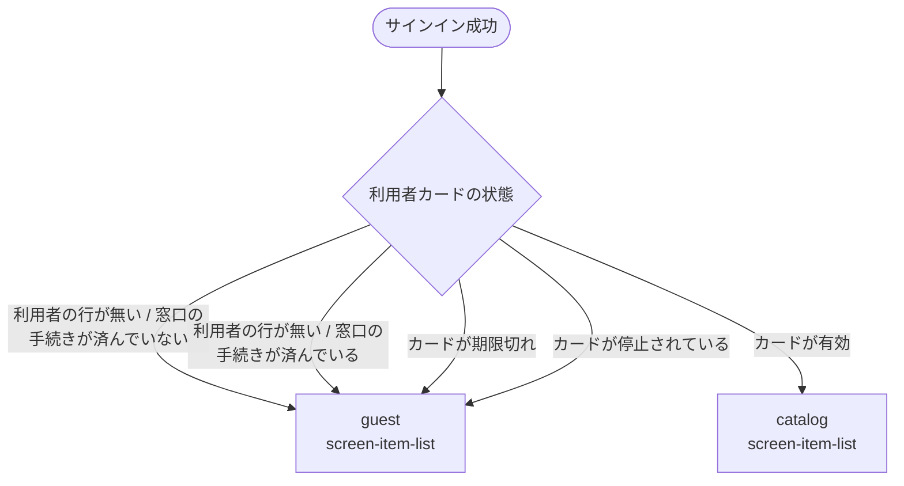

# 認証フロー — サインインすると何が起きるか

- **主語は状態機械ではない。** 利用者の在籍を状態機械で持たないシステム(この館では利用者の行そのものは窓口の台帳が正)なので、主語の軸は `kind: field` で `patron.card` を指す。値の全体は entity_spec の `enum` が正であり、カードの状態を 1 つ足したら着地の宣言が要る(H1)。
- **軸の名前は `card` / `desk` である。** 決定表の軸の名前は仕様の側の語であり、仕組みが特定の軸名を要求することは無い(束 ⑲-2a でここが開いた)。
- **サインインで操作を実行しない。** どの行も `runs` を持たない —— 利用者の行を作るのは窓口の登録であって、ログインではない。

<!-- AUTO-GENERATED:auth-body -->
### サインインの方式(宣言に無い方式が設定で開いていると H5 が止める)

| 方式 | 扱い |
| --- | --- |
| `email` | 本番でも受け入れる |

### セッションの寿命(設定が同じ値でないと H5 が止める)

| 寿命 | 長さ | 測り始め |
| --- | --- | --- |
| 無操作の時間切れ | `8h` | 最後にセッションを更新したとき |
| 絶対の寿命 | `24h` | サインインしたとき(更新トークンもここで使えなくなる) |

理由: 絶対の寿命は NIST SP 800-63B-4 §2.2.3 の AAL2 の上限(24 時間)に合わせる。無操作の時間切れは認証基盤が最後の更新から測るので、アクセストークンの寿命(1 時間)より長い 8 時間にする

同時に持てるセッションの数: 上限なし。理由: 認証基盤の既定のまま上限を置かない(利用者は複数の端末から使う)

### IdP とアプリのセッションの関係(書ける主張はいまの仕組みが支えられるものだけ — H0)

| 問い | 答え |
| --- | --- |
| アプリのログアウトは IdP のセッションをどうするか | アプリのログアウトは IdP のセッションを終えない(この端末のアプリのセッションだけを閉じる) |
| IdP のセッションが終わったとき・アカウントが失効したとき | IdP のセッションが終わっても、IdP のアカウントが失効しても、アプリのセッションはアプリの寿命(sessions)が来るまで続く |
| 寿命の揃え方 | アプリのセッションの寿命はアプリが決める(sessions)。IdP のセッションの寿命とは揃えない |

理由: 外部の IdP を使わない(メールのサインイン)ので、IdP のセッションは無い。IdP を足す日はこの宣言を見直す。ログアウトはこの端末のアプリのセッションだけを閉じる

### 多要素認証(外す宣言・IdP に任せる宣言は verify が毎回「受け入れた危険」として名指す — H6)

| 求める相手 | 済ませていない人の送り先 | 入場のたびに確かめる関数 | どういう要求か |
| --- | --- | --- | --- |
| ロール librarian | `screen-mfa` | `app/src/composition/auth.ts::requireMfa` | 司書の画面に入る前に 2 段階認証を求める(利用者の画面は求めない) |

### サインインの分岐(決定表を図にしたもの)

### 分岐の全数(主語の全状態を尽くしている。H1 が全域性を見る)

| 分岐 ID | 主語 | 条件 | 実行する操作 | 着地 | 何が起きるか |
| --- | --- | --- | --- | --- | --- |
| `no_patron_without_desk` | 利用者の行が無い | 窓口の手続きが済んでいない | — | `guest` | 利用者の行が無く窓口の手続きも済んでいない人は、目録を見るだけ |
| `no_patron_after_desk` | 利用者の行が無い | 窓口の手続きが済んでいる | — | `guest` | 窓口の手続きは済んでいるが行がまだ無い(反映は窓口の登録が正)ので目録だけ |
| `card_valid` | カードが有効 | — | — | `catalog` | 有効なカードを持つ利用者は通常の入口へ |
| `card_expired` | カードが期限切れ | — | — | `guest` | 期限切れのカードでは借りられない(更新は窓口の手続き) |
| `card_revoked` | カードが停止されている | — | — | `guest` | 停止されたカードは入り直しても自動で戻らない |

### 着地(サインインの結末。案内画面の出し分けと双方向に閉じている)

| 着地 ID | 着地する画面 | 画面の出し分け | どういう結末か |
| --- | --- | --- | --- |
| `catalog` | `screen-item-list` | — | 蔵書目録へ(貸出も予約もできる通常の入口) |
| `guest` | `screen-item-list` | — | 蔵書目録は見えるが、貸出と予約はできない(カードの手続きが要る) |

### 画面に入るときの関門(サインイン済みの人に対する資格の確認)

| 関門 ID | 何が呼ぶか | 通れなかった人 | 送り先 | 実装 | どういう関門か |
| --- | --- | --- | --- | --- | --- |
| `session` | 画面仕様の `requires_auth: true` | 送り返す | `screen-item-list` | `app/src/composition/auth.ts::requireSession` | ログインが要る画面に未ログインで来た人を目録へ送る |
| `librarian` | 画面仕様の `for: [librarian]` | 無いものとして扱う(not found) | — | `app/src/composition/auth.ts::requireLibrarian` | カウンターの画面に司書以外が来たら、中身を無いものとして扱う |

### テストケース

| ID | type | covers | spec_ids | implementation |
| --- | --- | --- | --- | --- |
| TC-AUTH-SIGNIN-001 | unit | other | auth-flow | `app/src/operation/__tests__/shared/sign-in-sync.test.ts::宣言した分岐のすべてで着地先が仕様どおりになる` |
<!-- /AUTO-GENERATED:auth-body -->
