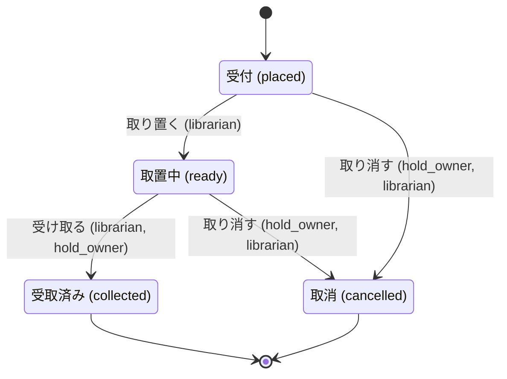

# 予約の状態

- 「期限切れ」の状態は置かない — 取置の期限が過ぎたら司書が取り消す(自動の走査はこの版で持たない)。

<!-- AUTO-GENERATED:state-diagram -->

<!-- /AUTO-GENERATED:state-diagram -->

<!-- AUTO-GENERATED:transition-table -->
| イベントID | from | to | by | guard | 書き留める時刻 | effects |
| --- | --- | --- | --- | --- | --- | --- |
| hold.prepare(取り置く) | placed(受付) | ready(取置中) | librarian | `item.state == available` | — | — |
| hold.collect(受け取る) | ready(取置中) | collected(受取済み) | librarian, hold_owner | — | — | — |
| hold.cancel(取り消す) | placed(受付), ready(取置中) | cancelled(取消) | hold_owner, librarian | — | — | — |
<!-- /AUTO-GENERATED:transition-table -->

<!-- AUTO-GENERATED:state-event-matrix -->
| 状態＼イベント | prepare(取り置く) | collect(受け取る) | cancel(取り消す) |
| --- | --- | --- | --- |
| placed(受付) | ✓→ready | ✗(o) | ✓→cancelled |
| ready(取置中) | ✗(o) | ✓→collected | ✓→cancelled |
| collected(受取済み) | ✗(o) | ✗(o) | ✗(o) |
| cancelled(取消) | ✗(o) | ✗(o) | ✗(o) |

凡例: `✓→{to}` = 遷移が定義されている / `✗(fN)` = 明示的な禁止(脚注 fN) / `✗(o)` = otherwise_forbidden による包括禁止 / `✗(?)` = 理由が書かれていない(V3 違反)

脚注:

- o: from に無い状態の包括禁止(otherwise_forbidden)。イベントごとの理由は次のとおり。
    - prepare(取り置く): 取り置けるのは受付済みの予約だけ
    - collect(受け取る): 受け取れるのは取置中の予約だけ
    - cancel(取り消す): 受取済みの予約は取り消せない(取消は取り置きまでの間だけ)
<!-- /AUTO-GENERATED:state-event-matrix -->
