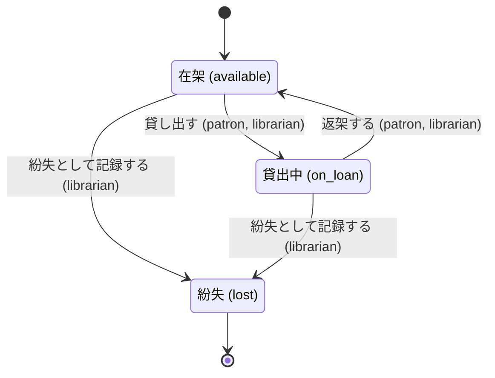

# 蔵書の状態

- 「修理中」「除籍」は状態に足さない — この版では館内の在庫運用を扱わない線引き。

<!-- AUTO-GENERATED:state-diagram -->

<!-- /AUTO-GENERATED:state-diagram -->

<!-- AUTO-GENERATED:transition-table -->
| イベントID | from | to | by | guard | 書き留める時刻 | effects |
| --- | --- | --- | --- | --- | --- | --- |
| item.lend(貸し出す) | available(在架) | on_loan(貸出中) | patron, librarian | — | — | — |
| item.shelve(返架する) | on_loan(貸出中) | available(在架) | patron, librarian | — | — | — |
| item.report_lost(紛失として記録する) | available(在架), on_loan(貸出中) | lost(紛失) | librarian | — | — | — |
<!-- /AUTO-GENERATED:transition-table -->

<!-- AUTO-GENERATED:state-event-matrix -->
| 状態＼イベント | lend(貸し出す) | shelve(返架する) | report_lost(紛失として記録する) |
| --- | --- | --- | --- |
| available(在架) | ✓→on_loan | ✗(o) | ✓→lost |
| on_loan(貸出中) | ✗(o) | ✓→available | ✓→lost |
| lost(紛失) | ✗(o) | ✗(o) | ✗(o) |

凡例: `✓→{to}` = 遷移が定義されている / `✗(fN)` = 明示的な禁止(脚注 fN) / `✗(o)` = otherwise_forbidden による包括禁止 / `✗(?)` = 理由が書かれていない(V3 違反)

脚注:

- o: from に無い状態の包括禁止(otherwise_forbidden)。イベントごとの理由は次のとおり。
    - lend(貸し出す): 貸出中・紛失の蔵書は貸し出せない(再貸出は返却してから)
    - shelve(返架する): 返架できるのは貸出中の蔵書だけ
    - report_lost(紛失として記録する): すでに紛失として記録した蔵書を二重に記録しない
<!-- /AUTO-GENERATED:state-event-matrix -->
