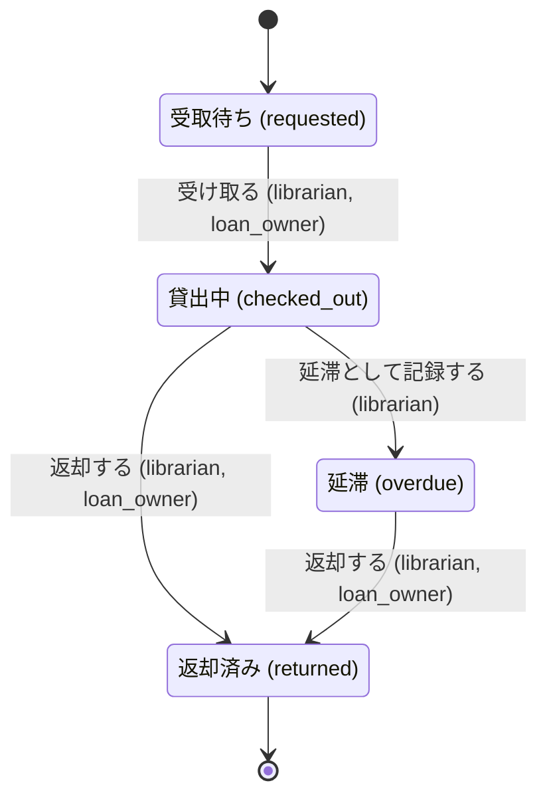

# 貸出の状態

- 「紛失」の状態は貸出に持たせない — 失われるのは蔵書であって貸出の記録ではない(蔵書側の状態)。

<!-- AUTO-GENERATED:state-diagram -->

<!-- /AUTO-GENERATED:state-diagram -->

<!-- AUTO-GENERATED:transition-table -->
| イベントID | from | to | by | guard | 書き留める時刻 | effects |
| --- | --- | --- | --- | --- | --- | --- |
| loan.check_out(受け取る) | requested(受取待ち) | checked_out(貸出中) | librarian, loan_owner | — | — | — |
| loan.report_overdue(延滞として記録する) | checked_out(貸出中) | overdue(延滞) | librarian | `now > loan.due_at` | — | notify_overdue_patron |
| loan.return_item(返却する) | checked_out(貸出中), overdue(延滞) | returned(返却済み) | librarian, loan_owner | — | — | — |
<!-- /AUTO-GENERATED:transition-table -->

<!-- AUTO-GENERATED:state-event-matrix -->
| 状態＼イベント | check_out(受け取る) | report_overdue(延滞として記録する) | return_item(返却する) |
| --- | --- | --- | --- |
| requested(受取待ち) | ✓→checked_out | ✗(o) | ✗(o) |
| checked_out(貸出中) | ✗(o) | ✓→overdue | ✓→returned |
| overdue(延滞) | ✗(o) | ✗(o) | ✓→returned |
| returned(返却済み) | ✗(o) | ✗(o) | ✗(o) |

凡例: `✓→{to}` = 遷移が定義されている / `✗(fN)` = 明示的な禁止(脚注 fN) / `✗(o)` = otherwise_forbidden による包括禁止 / `✗(?)` = 理由が書かれていない(V3 違反)

脚注:

- o: from に無い状態の包括禁止(otherwise_forbidden)。イベントごとの理由は次のとおり。
    - check_out(受け取る): 受け取れるのは受取待ちの貸出だけ(返却済みの再受取は新しい貸出として扱う)
    - report_overdue(延滞として記録する): 延滞に至るのは貸出中の貸出だけ
    - return_item(返却する): 返却できるのは受け取り済みの貸出だけ
<!-- /AUTO-GENERATED:state-event-matrix -->
